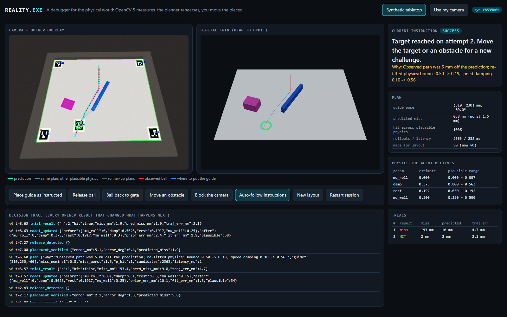
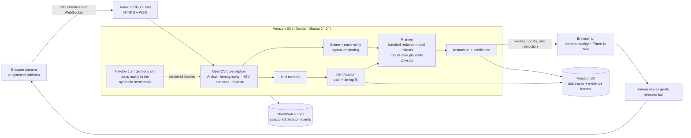

# REALITY.EXE — a debugger for the physical world

Point a camera at a tilted board with a ball, a movable guide and some obstacles, and give it a goal: *make
the ball reach this target*. REALITY.EXE measures the board with **OpenCV 5**, rehearses guide placements in
simulation on **AWS**, tells you exactly where to put the guide, verifies your placement from the camera,
watches the real roll, and, when reality disagrees with the prediction, **fits the physics to what it saw
and tries again**. If you move an obstacle while it is talking to you, it notices and discards the stale
plan before you act on it.

The camera is the experimental scientist; you are its hands.

- Technical report: [REPORT.md](REPORT.md)
- Evaluation results: [eval/results.md](eval/results.md), first-milestone clip: [eval/first_milestone.mp4](eval/first_milestone.mp4), example decision trace: [eval/trace_example.json](eval/trace_example.json)
- Competition path: **Agentic Vision with OpenCV 5**: OpenCV measurements change the next plan, instruction and model update.





## Run it locally (5 minutes)

Requires Python 3.12+ (tested on 3.12 in Docker and 3.14 on Windows).

```bash
python -m venv .venv
.venv/bin/pip install -r requirements.txt        # Windows: .venv\Scripts\pip
.venv/bin/python test_core.py                    # 6 checks, ~3 s
.venv/bin/uvicorn api:app --port 8000
```

Open <http://localhost:8000>. The **Synthetic tabletop** (default) needs no hardware: the server renders
camera frames of a board whose ball physics come from Newton with hidden parameters, and the agent only
sees those frames. Press **Auto-follow instructions** to watch the loop run itself, or use the buttons as
your hands: *Place guide*, *Release ball*, *Move an obstacle*, *Block the camera*.

**Use my camera** streams your webcam to the same agent (browsers allow camera access on `localhost` or HTTPS).

## The physical setup

| Item | Default (edit via a JSON file pointed to by `REALITY_CONFIG`, keys as in `scene.Config`) |
|---|---|
| Board | white foam board, 600 × 450 mm, tilted **8°** (measure with a phone inclinometer), rims on 3 sides, open bottom edge |
| Markers | print `python world.py --print-markers markers.png` at 100% scale: ids 0–3 at the corner centres (30, 30), (570, 30), (570, 420), (30, 420) mm, upright; id 4 is the **target**, place it anywhere |
| Ball | 40 mm orange ping-pong ball, released from a fixed gate at (300, 45) mm |
| Guide | 180 × 15 mm blue stick |
| Obstacles | magenta blocks (≈60 × 45 mm) |

Colour thresholds are in `Config.hsv` (OpenCV HSV, H 0–180). This is the calibration knob for your lighting.

## Evaluate

```bash
.venv/bin/python evaluate.py --quick   # 3 layouts, ~2 min
.venv/bin/python evaluate.py           # 10 layouts, adaptive vs fixed physics, obstacle-move and occlusion cases
```

Writes `eval/results.json`, `eval/results.md`, `eval/trace_example.json` and `eval/first_milestone.mp4`.

## Deploy to AWS (one CloudFormation stack)

From [AWS CloudShell](https://console.aws.amazon.com/cloudshell) (nothing to install):

```bash
git clone https://github.com/UditDewan/reality-exe.git reality && cd reality
aws cloudformation deploy --stack-name reality-exe --template-file deploy/cloudformation.yaml \
  --capabilities CAPABILITY_IAM --parameter-overrides RepoUrl=https://github.com/UditDewan/reality-exe.git
aws cloudformation describe-stacks --stack-name reality-exe --query "Stacks[0].Outputs" --output table
```

`AppUrl` is the judge-facing HTTPS endpoint (allow ~10 minutes for the Docker build and CloudFront). The stack
creates: EC2 (`t3.large`, Docker, IMDSv2 only, no SSH, Session Manager access), an encrypted private S3 bucket
with 30-day expiry for trial traces/evidence frames, a CloudWatch log group (14-day retention) receiving one
JSON line per agent decision, a least-privilege instance role (`s3:PutObject` to that bucket and log writes
only), and a CloudFront distribution for HTTPS/WebSockets. Cost is roughly $0.10/hour while running.

Tear down: `aws s3 rm s3://<TraceBucket> --recursive && aws cloudformation delete-stack --stack-name reality-exe`.

Without AWS: `docker build -t reality-exe . && docker run -p 8000:8000 reality-exe`.

## Demo video shot list (≤ 5 min)

1. **0:00–0:30 Team + problem:** tuning physical setups is trial and error, and the camera can do the science.
2. **0:30–1:00 Architecture:** the diagram above. OpenCV 5 runs on EC2 behind CloudFront, evidence goes to S3, decisions go to CloudWatch.
3. **1:00–2:30 The loop live** (`AppUrl`, synthetic tabletop, *Auto-follow*): prediction and ghosts → placement verified → real miss → *"re-fitted physics: …"* → new instruction → hit.
4. **2:30–3:15 Human control:** press *Move an obstacle* mid-instruction (plan discarded, layout version bumps), then *Block the camera* (clear-view request, nothing issued).
5. **3:15–4:15 Results:** `eval/results.md` (adaptive vs fixed physics, trajectory error, recovery, occlusion, latency), the trace, CloudWatch log lines, the S3 evidence objects.
6. **4:15–5:00 Limitations + responsible use:** synthetic-only results so far, human-in-the-loop by design, private 30-day evidence retention.

## API

| Endpoint | Purpose |
|---|---|
| `GET /health` | versions (OpenCV, Newton), live sessions, whether S3 tracing is on |
| `POST /api/observe` (multipart `image`) | stateless OpenCV check: board registration + measured ball/guide/obstacles/target in mm |
| `POST /api/plan` (JSON `{target, obstacles, guide?, params?}`) | stateless planning job, returns guide pose, predicted paths, instruction |
| `GET /api/sessions/{id}/trace` | full decision trace of a session |
| `WS /ws?mode=synthetic\|camera` | live loop: client sends frames (`float64 timestamp + JPEG`) or commands, server streams annotated frame + status |

## Code map

| File | Role |
|---|---|
| `vision.py` | OpenCV 5: ArUco detection, RANSAC homography, rectified top-down view, HSV segmentation, contours, `cv.KalmanFilter`, overlays |
| `scene.py` | typed scene, config, debounced change detection, layout version |
| `physics.py` | vectorized reduced model (thousands of rollouts per second) and Newton 1.7 rigid-body rollouts |
| `identify.py` | joint path + timing fit of effective physics across trials, quality gate, plausible set |
| `planner.py` | guide-pose search, robust scoring, human-readable instructions |
| `controller.py` | the agent's perception → decision → action loop and decision trace |
| `world.py` | synthetic tabletop renderer and scripted human; printable markers |
| `api.py`, `web/index.html` | FastAPI + WebSocket service; browser UI with Three.js digital twin |
| `evaluate.py`, `test_core.py` | benchmark and smoke checks |
| `Dockerfile`, `deploy/cloudformation.yaml` | pinned container and AWS stack |

Pinned stack: OpenCV 5.0.0 (`opencv-python-headless==5.0.0.93`), Newton 1.7.0, Warp 1.18.0, NumPy 2.5.4,
FastAPI 0.162.0, Ubuntu 24.04 pinned by digest. The full lock is in `requirements.txt`.
