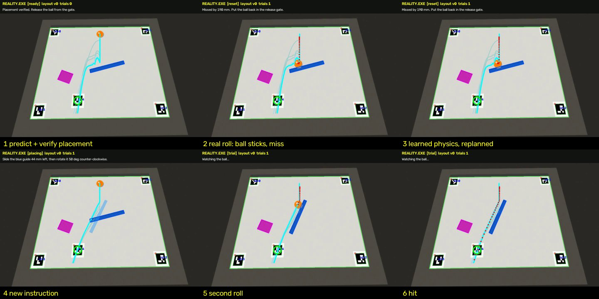
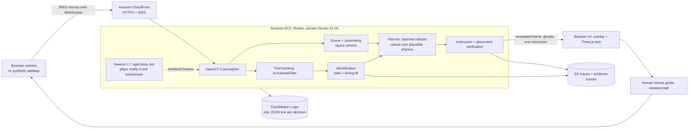

# REALITY.EXE: technical report

*OpenCV AI Competition 2026, powered by AWS. Path: **Agentic Vision with OpenCV 5**.*

## 1. Problem and users

Physical setups such as marble runs, conveyor chutes, lab fixtures and classroom ramps get tuned by trial and
error. People nudge a part, try again, and rarely know *why* an attempt failed. Simulation could help, but a
simulator is only as good as its parameters, and nobody measures rolling resistance or wall friction before
moving a guide rail.

REALITY.EXE closes that loop with a camera. It measures the physical layout with OpenCV 5, rehearses
candidate changes in simulation, tells a person exactly what to move, checks from the camera that they moved
it, watches the real outcome, and, when the outcome disagrees with the prediction, fits its physics to the
observed motion and plans again.

**Users:** students and teachers (a hands-on lab in measurement, modelling and the scientific method), makers
and hobbyists tuning contraptions, and, as the larger target, technicians commissioning small part-handling
fixtures, where "camera + model + human hands" is cheaper than a robot.

The prototype is deliberately constrained to one tabletop task: a tilted board, a ball released from a fixed
gate, one movable guide, obstacles, and a target marker. The goal is *"make the ball reach this target"*.

## 2. What the system does (the demo)

1. The screen overlays the predicted path (cyan) and ghost paths on the camera feed. The ghosts are the same
   plan under other plausible physics, plus runner-up plans.
2. It proposes a guide pose, shows it as a translucent ghost on the camera image, and gives one instruction,
   e.g. *"Slide the blue guide 44 mm left, then rotate it 50° counter-clockwise."*
3. It verifies the placement from the camera (≤10 mm, ≤4°, 5 consecutive frames), then re-predicts with the
   **measured** pose instead of the instructed one.
4. If you move an obstacle at any point before release, the layout version bumps, the stale instruction is
   discarded, and it replans.
5. You release the ball. It tracks the ball, detects hit or miss, and compares the observed path with the
   predicted one.
6. On a miss it fits rolling resistance, speed damping, bounce and guide friction to every trial so far, then
   produces a better plan. On a hit it waits for a new challenge.



The first-milestone clip ([eval/first_milestone.mp4](eval/first_milestone.mp4), read the frames left to right,
then top to bottom) shows a predicted trajectory, a real miss (the ball sticks on a shallow guide that the
prior physics thought was slippery), and a visibly corrected second plan that hits.

## 3. Architecture



All perception, planning, identification and simulation run server-side on AWS. The browser only captures
frames and renders results.

### Agent workflow (perception → decision → action, human in the loop)

```mermaid
stateDiagram-v2
    [*] --> calibrating
    calibrating --> placing: board, ball, guide, target measured / plan
    placing --> placing: guide pose measured / live instruction
    placing --> placing: obstacle or target moved / invalidate + replan
    placing --> ready: placement verified from camera / re-predict with measured pose
    ready --> placing: guide disturbed or layout changed
    ready --> trial: release detected (ball moved 20 mm)
    trial --> learning: ball exits, stops, or 6 s
    learning --> success: observed hit
    learning --> reset: observed miss / fit physics if tracking quality ok
    reset --> placing: ball back in gate / replan with new physics
    success --> reset: new layout seen
    note right of placing: any state: fewer than 3 board markers or bad registration<br/>means request a clear view, hold, no new instruction
```

The OpenCV results that change what the agent does next:

| OpenCV result | What it changes |
|---|---|
| Board registration fails (fewer than 3 markers, or reprojection error > 5 mm) | Agent requests a clear view, freezes the plan, issues no instruction |
| Obstacle or target pose changes for 3 frames | Layout version bumps, the pending instruction is discarded, replan |
| Measured guide pose | Live instruction text; verification gate; the prediction uses the measured pose |
| Ball displacement | Release detection, which starts the trial |
| Kalman-tracked ball trajectory | Hit/miss, trajectory error, and physics refit, which change the next plan |
| Tracking gaps (> 250 ms) or short tracks | The model update is skipped for that trial |

**Example trace** (`eval/trace_example.json`, abridged). The OpenCV-measured trajectory drives a model update
that changes the next tool call (the plan) and the next human action:

```json
{"t": 0.03, "scene_version": 0, "event": "plan", "guide": [340, 230, -15], "miss_nominal": 2.3, "p_hit": 1.0, "latency_ms": 289}
{"t": 0.20, "scene_version": 0, "event": "placement_verified", "error_mm": 4.2, "error_deg": 1.4, "predicted_miss": 7.4}
{"t": 1.87, "scene_version": 0, "event": "model_updated", "before": {"damp": 0.1, "mu_wall": 0.15}, "after": {"damp": 0.94, "mu_wall": 0.25}, "prior_err_mm": 10.7, "fit_err_mm": 2.0}
{"t": 1.87, "scene_version": 0, "event": "trial_result", "n": 1, "hit": false, "miss_mm": 190.2, "pred_miss_mm": 7.4}
{"t": 4.63, "scene_version": 0, "event": "plan", "guide": [295, 230, -64], "miss_nominal": 1.9, "p_hit": 1.0, "latency_ms": 328}
{"t": 6.93, "scene_version": 0, "event": "trial_result", "n": 2, "hit": true, "miss_mm": 2.5, "pred_miss_mm": 3.3}
```

## 4. OpenCV 5 implementation (`vision.py`)

Every frame goes through this pipeline, about 11 ms per 960×720 frame on one laptop core:

1. **Marker detection:** `cv.aruco.ArucoDetector` (DICT_4X4_50) with sub-pixel corner refinement. Ids 0–3
   sit at known board positions, and id 4 is the user-placed target.
2. **Board registration:** all visible corner correspondences (up to 16) feed `cv.findHomography` with
   RANSAC (4 mm threshold) from image pixels to board millimetres. Reprojection error is computed with
   `cv.perspectiveTransform` and gates confidence. With fewer than 3 markers, or more than 5 mm of error,
   the frame counts as uncertain.
3. **Rectification:** `cv.warpPerspective` produces a 1 px/mm top-down board image, so object sizes are
   known in pixels and thresholds are lighting- and pose-independent geometry.
4. **Segmentation:** `cv.cvtColor` to HSV, then `cv.inRange` per object class (ball, guide, obstacles),
   then `MORPH_OPEN` and `MORPH_CLOSE` with an elliptical kernel.
5. **Ball:** `cv.findContours`, area gate against the known radius, circularity from
   `cv.minEnclosingCircle` (≥0.45, tolerating motion blur), and the centroid from `cv.moments`.
6. **Guide and obstacles:** `cv.minAreaRect` gives the centre, long-axis angle and size. The guide's
   confidence is its visible area against its known dimensions, so a partially occluded guide cannot pass
   placement verification.
7. **Velocity:** a constant-velocity `cv.KalmanFilter` in board millimetres, with the transition matrix
   rebuilt from each frame's real timestamp, re-initialised on gaps or jumps.
8. **Quality signals:** marker count, reprojection error, and Laplacian-variance sharpness, all logged per
   frame.
9. **Overlay:** board-frame trajectories, the instructed guide pose and detections are projected back
   through the inverse homography (`cv.perspectiveTransform`, `cv.polylines`, `cv.fillPoly`,
   `cv.addWeighted`, `cv.aruco.drawDetectedMarkers`).

## 5. Physics, planning and learning

**Reduced model (`physics.simulate`).** A vectorized NumPy integrator for a ball on a plane tilted by θ.
Gravity along the slope is `k·g·sinθ`, with `k = 0.6` for a thin-shell ball rolling without slipping.
Rolling resistance is `μ_r·g·cosθ` and speed damping is `c·v`. Ball-vs-oriented-box contacts with
restitution `e` (no bounce below 30 mm/s) and Coulomb friction impulses `μ_w`, plus board rims. It rolls
thousands of candidates in lockstep: 1,000 rollouts in about 0.03 s.

**Newton 1.7 (`physics.newton_rollout`).** The same scene as Newton primitives: a ground plane under tilted
gravity, a 2.7 g thin-shell sphere on a free body, static boxes for the guide, obstacles and rims, one Newton
world per candidate, solved with `SolverXPBD` on CPU through Warp 1.18. We benchmarked it before choosing
roles, as the original plan required. On CPU it costs about 0.5 ms per world-step including model build
(4 worlds × 2,000 steps took 4.3 s), roughly four orders of magnitude slower per rollout than the reduced
model. A 2,000-rollout search plus a parameter fit after every trial would take minutes. So Newton plays
**reality** in the reproducible benchmark, and the agent plans with the reduced model it calibrates online.
This is a real model gap, not a toy one: in Newton the ball sticks on shallow guides because of
contact-geometry friction effects the reduced model does not represent directly. The agent has to learn its
way across that gap from camera observations alone. GPU batching of Newton worlds (CUDA graphs) is the
upgrade path, and the code already builds one world per candidate.

**Planner (`planner.py`).**
1. Grid over guide x, y and angle (±10–60°) inside the allowed region, about 1,800 poses. Remove any that
   overlap obstacles, the target or the release gate.
2. Coarse rollout under the best-estimate physics.
3. Local refinement around the top 6 (±15 mm, ±4°).
4. Robust re-scoring of about 500 candidates under every plausible parameter sample:
   `0.5·mean miss + 0.5·worst miss + 15 mm if it touches an obstacle + small effort cost` for moving the guide
   far from where it already is.

That is about 2,000 rollouts per plan, with a median latency of about 0.33 s on CPU.

**Identification (`identify.py`).** The parameters are fitted jointly to **all** trials so far. Each trial
is simulated with the guide pose and obstacles as they actually were. The error combines path-shape distance
with **timing error**: positions compared at equal times since release detection, which pins down speed.
Path shape alone left rolling resistance and damping unidentifiable in early tests, and fits jumped between
trials. The search runs a 980-point grid, then a 3⁴ refinement. All parameter sets within `1.25×best + 1 mm`
form the plausible set, and its per-parameter extremes become the robustness samples for the next plan. The
update only runs when tracking quality is sufficient: at least 10 fixes, a span of at least 30 mm, and no
gap longer than 250 ms. An earlier 120 mm span gate threw away the most informative trials, the ones where
the ball *sticks* on the guide. On two benchmark layouts the agent then repeated the same doomed plan five
times, so the gate was lowered.

**Language model.** None is in the decision path, by design. Geometry, physics, success detection and
ranking come from measured data and numerical code. Explanations ("why the plan changed") are generated from
the structured decision records, so they cannot hallucinate.

## 6. AWS deployment (`deploy/cloudformation.yaml`)

One CloudFormation stack, deployable from AWS CloudShell with one command (see README):

- **Amazon EC2** (`t3.large`, Amazon Linux 2023) builds and runs the pinned Docker image (Ubuntu 24.04 by
  digest, OpenCV 5.0.0, Newton 1.7.0, Warp 1.18.0). The build pre-compiles Newton's CPU kernels and runs
  `test_core.py`, so a broken image fails at build time, not in front of a judge.
- **Amazon CloudFront** gives the HTTPS + WebSocket front door. HTTPS is required for browser camera access.
  Caching is disabled and the managed AllViewer policy forwards the upgrade headers.
- **Amazon S3** stores trial evidence: the full decision trace per session plus one annotated frame per
  trial. The bucket blocks public access, uses SSE-S3 encryption and expires objects after 30 days.
- **Amazon CloudWatch Logs** gets one structured JSON line per agent decision (session, layout version,
  event, parameters) through Docker's awslogs driver, kept for 14 days.
- **Security:** least-privilege instance role (`s3:PutObject` to one bucket, log writes to one group),
  IMDSv2 required, no SSH port (Session Manager instead), encrypted EBS, input-size limits and a command
  allowlist on the WebSocket, and a cap on concurrent sessions.
- **Reproducibility:** `requirements.txt` is a full lock, the base image is pinned by digest, and the
  benchmark is seeded (`python evaluate.py`).

## 7. Evaluation

Method: a seeded synthetic tabletop. **Newton 1.7 is reality**, and every layout gets its own hidden surface
(Newton friction, restitution and rolling resistance each scaled by a random 0.75–1.25×). The agent only sees
rendered 960×720 camera frames with perspective, blur and sensor noise. A scripted human follows the
instructions with realistic placement error (σ = 2.5 mm, 1.2°) and release jitter (σ = 1 mm). We compare
the adaptive agent against **the same planner with fixed prior physics**.

Results from `python evaluate.py`, 10 layouts. Full output is in `eval/results.md` and `eval/results.json`.

| Metric | Adaptive (fits physics from camera) | Same planner, fixed prior physics |
|---|---|---|
| Target hit on trial 1 | 40% | 40% |
| Target hit within 2 trials | **90%** | 40% |
| Target hit within 3 trials | **100%** | 40% |
| Target hit within 5 trials | **100%** | 40% |
| Trajectory error, trials 1 → 2 → 3 (mm) | 12.0 → **3.2** → **1.6** | 12.0 → 9.8 → 10.4 |

| Check | Result |
|---|---|
| Planning latency (laptop CPU, ~2,000 rollouts per plan) | median 334 ms, p95 505 ms over 51 plans |
| Obstacle moved while the human is being instructed | detected and plan invalidated 10/10; replanned on the new layout version 10/10; human actions taken on a stale plan 0; target later reached 9/10 |
| Camera blocked after placement, then mid-roll | clear view requested and nothing issued while blocked; resumed when restored; the mid-roll trial (467 ms tracking gap) was not learned from; the ball was then seen hitting, so the hit stands (an unobserved miss would be reported as *unknown*, covered by `test_core.py`) |
| Repeatability (first technical checkpoint: 8 releases of one setup, 1 mm gate jitter) | exit point σ 3.8 mm (x), 0.9 mm (y); distance-to-target σ 3.7 mm, well under the 22 mm target radius |
| OpenCV accuracy vs. renderer ground truth (mean / p95) | ball 0.29 / 0.50 mm; guide 0.15 / 0.32 mm and 0.05 / 0.13°; 11 ms per frame |

**What the numbers say.**
- **Learning is what moves the hit rate.** On the 4 layouts where the prior physics happened to be
  adequate, both agents hit on the first try with the same plan, as they should: same planner, same
  beliefs. On the other 6, the adaptive agent recovered within one or two extra trials, while the
  fixed-physics agent never hit in five tries. It keeps re-proposing nearly the same doomed plan because
  nothing it believes has changed.
- **Prediction error is the cleaner signal.** The gap between predicted and observed paths falls from
  12 mm to 3.2 mm after one observed roll and 1.6 mm after two. The fixed model stays near 10 mm.
- **Perception is not the bottleneck in this setting.** OpenCV measurement error (about 0.3 mm) is two
  orders of magnitude below the physics-model error the agent has to learn away. On a real camera this
  margin will shrink (see Limitations).
- **The setup is predictable enough to plan against.** Release-to-release spread is about 4 mm, well
  under the 22 mm target radius. That answers the plan's first technical checkpoint.

**Failure cases we observed.**
- **Qualitatively wrong priors.** On some layouts the ball *sticks* on a shallow guide that the prior
  believed was slippery. First attempts there missed by 60–296 mm. The adaptive agent recovered; the fixed
  baseline did not.
- **Partial identifiability.** One roll along one guide constrains the physics only for similar paths. On
  layout 3 the second plan still missed by 39 mm, and the hit came on trial 3. The joint multi-trial fit
  and the robust scoring shrink this, but do not remove it.
- **A replan that does not succeed.** In 1 of 10 obstacle-move runs (layout 3) the agent detected the
  move and replanned correctly, but did not reach the target within 5 trials.
- **Two bugs the benchmark caught and we fixed:**
  - The quality gate originally discarded short tracks (span < 120 mm), the very trials where the ball
    sticks. Learning stalled on 2 layouts: 80% → 100% within 3 trials after the fix.
  - A camera blocked mid-roll originally ended the trial early, and the agent learned from a truncated
    track. Now a blocked view pauses the lost-ball clock, the gap fails the quality gate, and an unobserved
    miss is reported as *unknown*, with a request to repeat the roll. `test_core.py` has a regression test
    for this case.

**Important: these are synthetic results.** We have not yet run repeated physical trials. The physical
pipeline (browser camera, then the same agent) is implemented and its perception is unit-tested on rendered
frames only. Physical-world hit rates, trajectory errors and latency over a real network are not measured
and should not be read into the table above.

## 8. Limitations

- **Real-camera effects not modelled:** the ball's centre sits r = 20 mm above the board, so an oblique
  camera sees parallax of a few millimetres that a plane homography does not remove (fixable with known
  camera height or a second marker plane). Motion blur at 30 fps limits tracking above about 1.5 m/s.
- **HSV thresholds** depend on lighting. They are exposed as config (the calibration knob) but not
  auto-calibrated.
- **Reduced 2D model:** no spin, no ball-height effects, and a single straight guide. Complex contraptions
  need Newton in the loop (GPU) or a richer reduced model.
- **Search** is grid plus local refinement, fine for 3 DOF. More movable parts would need CEM or
  gradient-based search (Warp/Newton are differentiable).
- **Single-tenant sessions** are held in memory on one instance. Scaling out needs sticky sessions or moving
  state out of process.
- **The 3D room-scale expansion** (3D Model Anything import) from the original plan is not built. The webcam
  prototype stands on its own, as intended.

## 9. Responsible use

- **Human control:** the agent never moves anything itself. It proposes, a person acts, and the camera
  verifies. Every instruction is pinned to the layout version it was computed from, and stale instructions
  are discarded *before* the person is asked to act. When the view is unclear it says so, holds, and issues
  nothing.
- **Privacy:** frames are processed in memory. Only one annotated evidence frame per trial and the numeric
  trace are stored, in a private, encrypted bucket that deletes them after 30 days. No face or person
  analysis is done; a person entering the frame only shows up as "camera view unclear". Deployers should
  tell people in view that a camera is recording evidence frames, or turn S3 off by leaving `TRACE_BUCKET`
  unset.
- **Honest uncertainty:** the UI shows the plausible-physics spread (ghost paths, hit probability across
  plausible parameters, parameter ranges), and the report separates synthetic results from untested
  physical claims.
- **Safety scope:** a tabletop toy-scale system. Using the approach for heavier or faster machinery would
  need hard safety interlocks independent of the vision system.

## 10. Reproduce

```bash
pip install -r requirements.txt && python test_core.py && python evaluate.py && uvicorn api:app
```

Requirements checklist: OpenCV 5 image/video analysis ✓ (`vision.py`) · meaningful AWS component ✓ (all
perception, planning and simulation on EC2; S3, CloudWatch, CloudFront) · report ✓ · repository ✓ · pinned
dependencies and instructions ✓ (README) · architecture and agent workflow diagrams ✓ (above) · web endpoint
✓ (CloudFormation output `AppUrl`) · evaluation with failure cases ✓ (section 7) · trace showing OpenCV output
changing a later decision ✓ (section 3).
